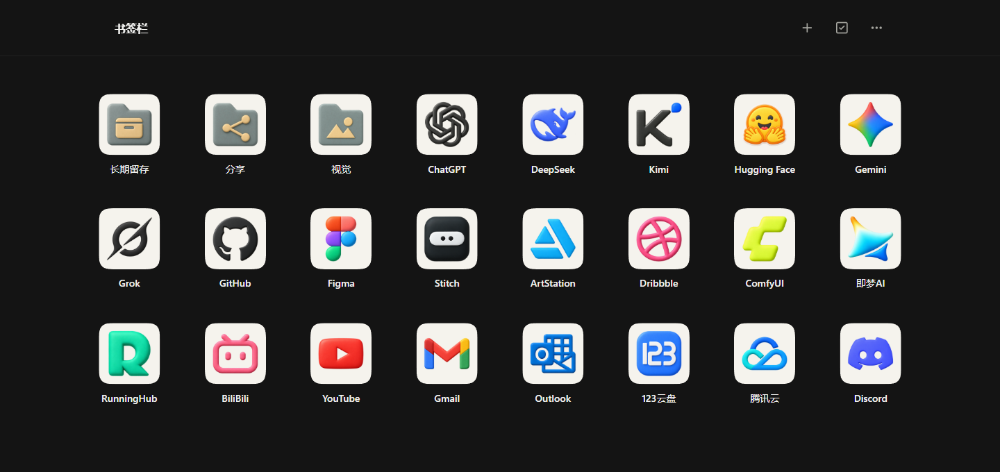
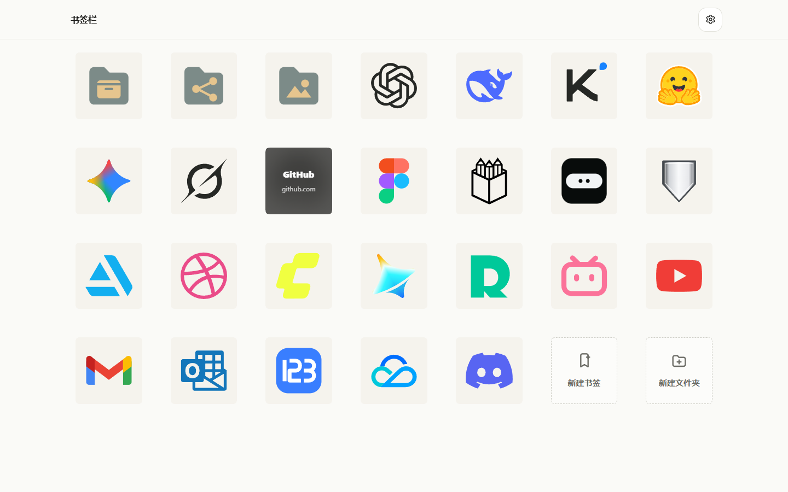
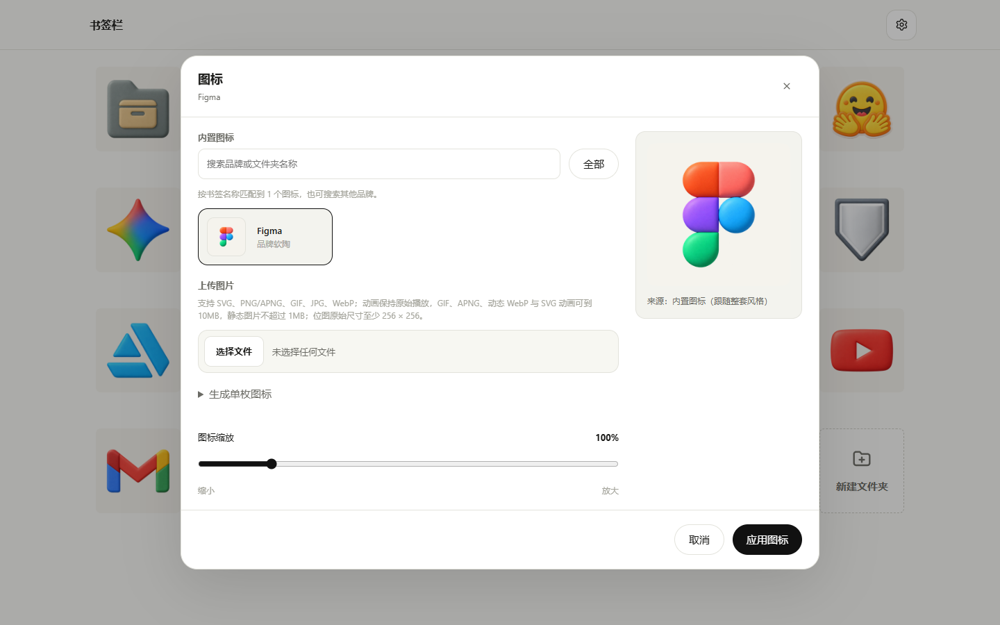

<div align="center">


# MarkPad

面向鼠标和触控操作的 Chrome 新标签页书签面板。<br>
把书签栏变成方形卡片，直接打开和整理 Chrome 原生书签，无需导入。

[预览](#界面预览) · [功能](#功能) · [兼容性](#浏览器兼容性) · [安装](#安装) · [使用](#使用) · [快捷键](#快捷键) · [路线规划](#路线规划) · [项目结构](#项目结构) · [验证](#验证) · [权限与数据](#权限与数据)

[](manifest.json) [](#安装) [](manifest.json) [](https://github.com/XGWNJE/MarkPad/actions/workflows/ci.yml)

</div>

## 界面预览

截图来自当前界面，使用公开站点的示例书签，展示默认 32% 大连续圆角；浅深主题与图标风格可分别切换。



**深色 · 品牌软陶** — 书签与文件夹排成方形卡片，保留品牌颜色、统一留白与圆角。

<details>
<summary>查看浅色 · 彩色扁平</summary>



轻盈的平面图标；标题常显，鼠标和触控均单次打开。

</details>

**图标工坊** — 搜索内置图标、上传图片，或复制提示词自行生成；应用前查看效果。



## 功能

- **浏览书签**：用卡片打开网站、进入文件夹，通过面包屑返回上级。
- **整理书签**：通过固定入口新建、重命名、批量移动和确认删除；移动面板也可调整当前目录的顺序。
- **快速收藏**：点击 Chrome 工具栏的 MarkPad 图标，将当前页面添加到书签栏；同一完整地址不重复添加。
- **触控操作**：点击与轻触共用打开和整理路径；右键、长按和键盘提供快捷操作。
- **调整外观**：切换浅色／深色、品牌软陶／彩色扁平图标，调整卡片与文字；上传图标并调整背景与缩放。

当前版本：`0.6.2`，以 [manifest.json](manifest.json) 为准。

## 浏览器兼容性

主要面向最新版桌面 Chrome。Ego Lite 的主要功能已实测，鼠标拖拽经用户确认通过；Edge、Brave、Vivaldi 预计兼容，尚未逐一实测。Opera、Firefox、Safari 当前包不兼容。实测范围、限制及依据见[浏览器兼容性表](docs/browser-compatibility.md)。

## 安装

需要桌面版 Chrome 和本仓库文件。扩展可直接加载，无需安装 Node.js、安装依赖或构建。

1. 下载并解压本仓库，或运行 `git clone https://github.com/XGWNJE/MarkPad.git`。
2. 在 Chrome 地址栏打开 `chrome://extensions/`，开启「开发者模式」。
3. 点击「加载已解压的扩展程序」，选择包含 `manifest.json` 的 MarkPad 根目录。
4. 打开新标签页，即可看到书签栏中的卡片；空文件夹也保留顶部新建入口。

更新仓库文件后，在扩展管理页重新加载 MarkPad，再打开新标签页。

## 使用

| 想做什么 | 操作 |
| --- | --- |
| 打开网站或文件夹 | 点击对应卡片；书签默认在当前页打开，可在设置中改为后台新标签页。 |
| 识别卡片 | 图标下方始终显示短标题；长名称可在整理操作或图标工坊中查看。 |
| 新建书签或文件夹 | 点击顶部「＋」，选择书签或文件夹，在当前目录创建。 |
| 收藏当前页面 | 点击 Chrome 工具栏的 MarkPad 图标，保存网页或本地文件页面的标题与完整地址到书签栏；`✓` 表示已添加，`=` 表示已收藏，`!` 表示失败，`?` 表示页面不支持或正在跳转。悬停查看说明。 |
| 编辑、移动或删除 | 点击顶部勾选按钮进入整理，选择卡片后操作；窄窗下部分动作收进「更多」。移动支持多选及同目录排序，删除先确认并显示文件夹子项数。 |
| 拖拽整理 | 鼠标拖动时邻卡让位；文件夹边缘排序，中央停留出现「移入文件夹」后松手移入。窗口左侧移动面板选择目录，右侧删除区域进入确认。 |
| 更换或调整图标 | 在「更多 → 设置」切换整套风格；整理时选中一张卡片打开图标工坊，可搜索、上传或复制单枚生成模板。 |
| 调整外观与打开方式 | 顶部「更多 → 设置」分外观、文字、操作三个页签；「更多 → 帮助」集中说明操作和限制。 |

工具栏未显示 MarkPad 时，在 Chrome 的扩展菜单（拼图图标）中将它固定。快速收藏不支持浏览器内部页和 MarkPad 新标签页；结果提示在页面跳转后清除。

页面内的[帮助](help.html)提供操作说明；网站图标缓存、上传限制及背景编辑见[触控与图标说明](docs/touch-icon-guide.md)；配色与界面约定见[品牌与视觉规范](docs/markpad-brand-visual-guide.md)。

## 快捷键

在新标签页内使用；输入框中的按键不触发全局快捷键。

| 按键 | 操作 |
| --- | --- |
| `N` / `Shift+N` | 在当前文件夹新建书签／文件夹 |
| `Backspace` / `Alt+←` | 返回上级 |
| 方向键 | 在卡片间移动焦点 |
| `Enter` / `Space` | 打开卡片；整理时切换选择 |
| `F2` | 编辑聚焦卡片的名称 |
| 菜单键 / `Shift+F10` | 打开聚焦卡片的操作菜单；上下方向键选择，Enter／空格执行 |
| `Delete` | 整理时删除所选项目；普通模式删除聚焦卡片，均先确认 |
| `Ctrl+点击` / `⌘+点击` | 切换卡片的选中状态，可多选 |
| `=` / `+` / `-` | 放大／缩小卡片 |
| `Ctrl+A` / `⌘A` | 整理时全选 |
| `Escape` | 关闭弹层或退出整理 |
| `?` | 打开帮助 |

## 路线规划

> **暂无。** 当前没有已公布的未来规划。

## 项目结构

| 位置 | 职责 |
| --- | --- |
| [index.html](index.html)、[main.js](main.js)、[help.html](help.html) | 新标签页、应用入口与独立帮助 |
| [components/](components/)、[css/](css/) | 界面组件与样式 |
| [core/](core/)、[background.js](background.js) | 书签数据、导航、图标解析、工具栏快速收藏与后台抓取 |
| [icons/](icons/)、[vendor/](vendor/) | 应用图标与内置第三方代码 |
| [tests/](tests/)、[scripts/](scripts/) | 行为测试与资源生成脚本 |
| [docs/](docs/) | 当前行为、视觉与工程专题说明 |

详细文件职责、数据边界及运行资源见[工程指南](docs/engineering-guide.md)；Agent 协作规则见 [AGENTS.md](AGENTS.md)。

## 验证

运行自动测试需要 Node.js。在仓库根目录执行：

```powershell
npm test
```

预期结果是 Node 行为测试全部通过。推送到 GitHub 或提交合并请求时，[CI](.github/workflows/ci.yml) 会在 Node 24 上执行同一命令；按模块选择的检查、版本一致性测试和 Chrome 运行态验收要求见[工程指南的验证清单](docs/engineering-guide.md#验证)。

## 权限与数据

| 声明 | 用途 |
| --- | --- |
| `bookmarks` | 读取、创建、修改、移动和删除 Chrome 书签。 |
| `storage` | 在本机保存自定义图标、网站图标缓存和显示偏好。 |
| `tabs` | 在新标签页或当前标签页打开书签；点击工具栏图标时读取当前页面标题与地址以创建书签。 |
| `<all_urls>`（网站访问权限） | 按需读取 HTTP(S) 书签网站的图标声明及图片资源。 |

**新建、快速收藏、编辑、移动和删除会直接修改 Chrome 原生书签。** MarkPad 没有独立的书签库；外观设置和图标数据保存在本机。网站图标把图标字节缓存在本机，卡片显示不再联网，只有首次获取、失败重试或手动重新获取时才会向对应网站发起请求。
